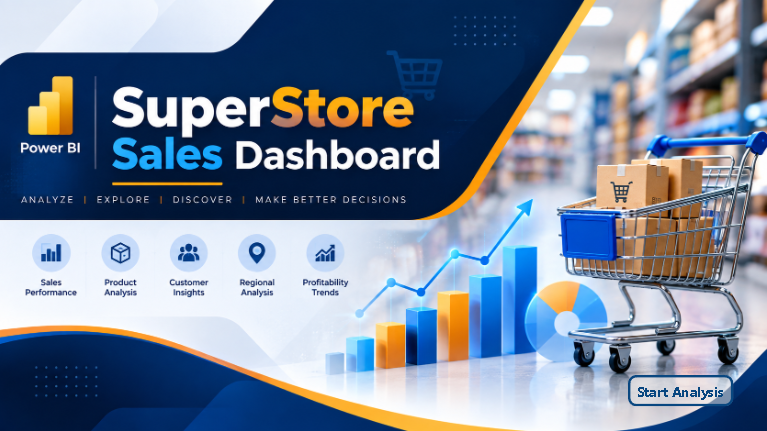
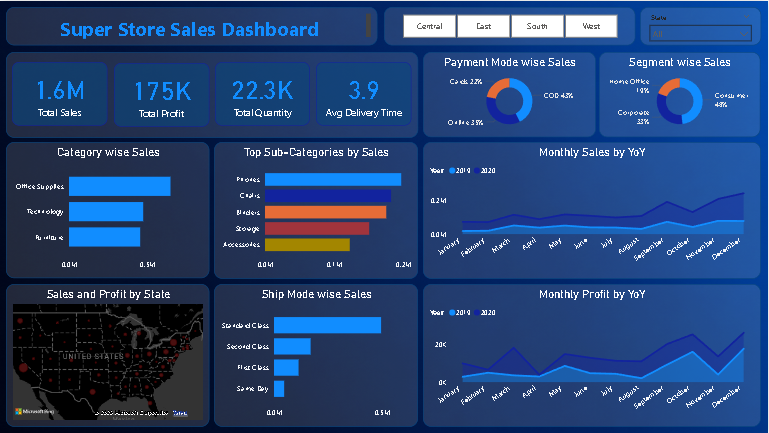
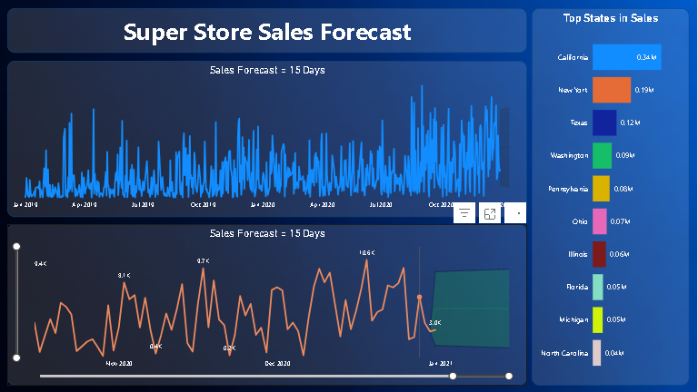

# 🛒 SuperStore Sales Dashboard | Power BI



## 📌 Project Overview

The **SuperStore Sales Dashboard** is an interactive Business Intelligence dashboard developed using **Microsoft Power BI** to analyze retail sales performance and forecast future sales trends.

The dashboard transforms raw sales data into meaningful business insights through interactive visualizations, KPI cards, filters, and forecasting.

---

## 🎯 Objectives

- Analyze overall sales performance
- Monitor profit and quantity sold
- Identify top-performing products and categories
- Analyze regional sales distribution
- Understand customer purchasing segments
- Compare monthly sales and profit trends
- Forecast future sales using Power BI Forecast

---

# 📊 Dashboard Pages

## 🏠 1. Landing Page

A modern landing page designed to provide an attractive entry point to the dashboard.

Features:

- Professional dashboard cover
- Navigation button
- Business theme
- Interactive start page

---

## 📈 2. Sales Dashboard



### Key Performance Indicators (KPIs)

- 💰 Total Sales
- 💵 Total Profit
- 📦 Total Quantity Sold
- 🚚 Average Delivery Time

### Interactive Filters

- Region
- State

### Visualizations

- Payment Mode Wise Sales
- Segment Wise Sales
- Category Wise Sales
- Top Sub-Categories by Sales
- Monthly Sales Trend
- Monthly Profit Trend
- Sales & Profit by State (Map)
- Ship Mode Wise Sales

---

## 🔮 3. Sales Forecast Dashboard



Forecasting Features

- 15-Day Sales Forecast
- Historical Sales Trend
- Future Sales Prediction
- Top States by Sales

---

# 📁 Dataset Information

The dataset contains retail sales information including:

- Order Date
- Ship Date
- Customer Details
- Product Details
- Category
- Sub-Category
- Region
- State
- Sales
- Profit
- Quantity
- Payment Mode
- Segment

---

# 🛠️ Tools & Technologies

- Microsoft Power BI
- Power Query
- DAX
- Data Modeling
- Forecast Analytics

---

# 📌 Dashboard Features

✔ Interactive Slicers

✔ KPI Cards

✔ Donut Charts

✔ Bar Charts

✔ Line Charts

✔ Forecasting

✔ Geographic Map

✔ Modern UI Design

✔ Dynamic Filtering

---

# 📊 Business Insights

The dashboard helps answer questions like:

- Which region generates the highest sales?
- Which product category performs best?
- Which sub-category contributes the most revenue?
- Which payment mode is preferred?
- Which customer segment purchases the most?
- Which states generate maximum profit?
- What are the expected sales for the next 15 days?

---

# 📷 Dashboard Preview

### Landing Page


---

### Sales Dashboard


---

### Forecast Dashboard


---

# 🚀 How to Use

1. Download the repository.
2. Open the `.pbix` file using Microsoft Power BI Desktop.
3. Refresh the dataset if required.
4. Interact with filters and visuals.

---

# 📂 Project Structure

```
SuperStore-Sales-Dashboard/
│
├── SuperStore Sales Dashboard.pbix
├── SuperStore_Sales_Dataset.csv
├── Dashboard.PNG
├── Forecast.PNG
├── Landing_Page.PNG
├── README.md
└── LICENSE
```

---

# 📈 Skills Demonstrated

- Data Cleaning
- Data Transformation
- Data Modeling
- DAX Measures
- KPI Development
- Dashboard Design
- Forecast Analysis
- Business Intelligence
- Data Visualization

---

# 👨‍💻 Author

**Sumeet Balu Dhobale**

📧 Email: sumeetdhobale34@gmail.com

🔗 LinkedIn: *(Add your LinkedIn Profile)*

💻 GitHub: https://github.com/sumeetdhobale

---

## ⭐ If you found this project useful, please consider giving it a Star!
